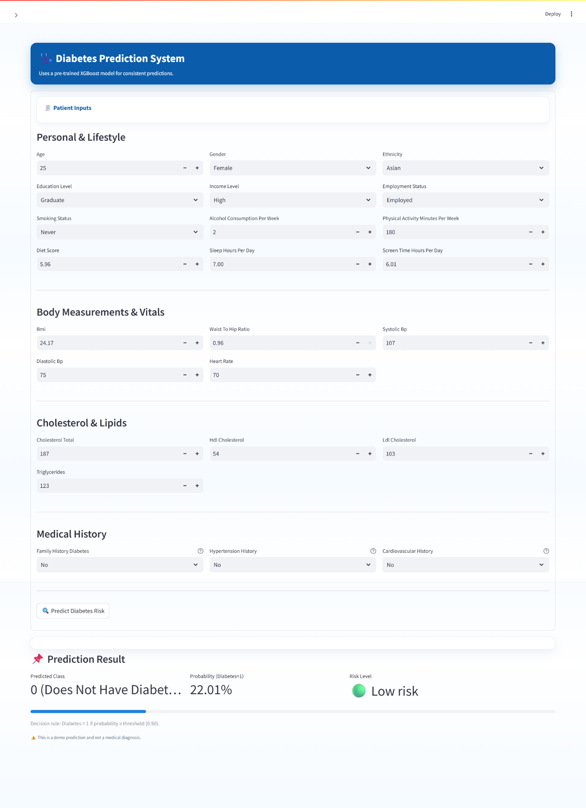

<p align="center">
  
</p>

<h1 align="center">Diabetes Prediction System 🩺</h1>

<p align="center">
  
  
  
  
  
</p>

<p align="center"><strong>Exploratory analysis &middot; Model comparison &middot; Interactive prediction</strong></p>

I built this project to take a machine learning workflow from exploratory analysis to an interactive application. Using **700,000 labeled records**, I compared five classifiers, evaluated their error patterns, and selected **XGBoost** for a Streamlit app. Its recorded holdout results: **68.27% accuracy** and **0.7241 ROC-AUC**.

## From Exploration to Model Selection

My focus was on making each modeling decision traceable to the data:

- **Understand the data.** Check missing values and duplicate rows, inspect distributions and correlations, and identify IQR outliers without removing them. With **62.33% positive labels**, accuracy alone gives an incomplete picture.
- **Build consistent preprocessing.** Use scikit-learn pipelines with one-hot encoding for categorical inputs. Scale numeric features for Logistic Regression and MLP, while passing them through unchanged for tree models.
- **Compare on a shared holdout.** Use a **stratified 80/20 split** with `random_state=42`, fitting preprocessing on the training partition and reserving **140,000 records** for evaluation.
- **Examine the tradeoffs.** Compare linear, tree, ensemble, and neural-network approaches through precision, recall, F1, ROC-AUC, confusion matrices, and ROC curves.

## Dataset and Inputs

The [Diabetes Health Indicators Dataset on Kaggle](https://www.kaggle.com/datasets/mohankrishnathalla/diabetes-health-indicators-dataset/data) covers health and lifestyle indicators. The notebook uses **24 predictors** spanning demographics, lifestyle, body measurements, and medical history to predict `diagnosed_diabetes`.

## Model Evaluation 📊

Results below are reported in the notebook's saved holdout evaluation. Precision, recall, and F1 refer to the positive class; **bold scores** mark the best result in each holdout metric.

| Model | Train Accuracy | Holdout Accuracy | ROC-AUC | Precision | Recall | F1 |
| --- | ---: | ---: | ---: | ---: | ---: | ---: |
| **XGBoost** | 0.6987 | **0.6827** | **0.7241** | **0.7050** | 0.8442 | 0.7683 |
| Random Forest | 0.6699 | 0.6653 | 0.6988 | 0.6734 | **0.8993** | **0.7701** |
| Multilayer Perceptron | 0.6657 | 0.6651 | 0.6950 | 0.6856 | 0.8547 | 0.7609 |
| Logistic Regression | 0.6633 | 0.6641 | 0.6948 | 0.6822 | 0.8633 | 0.7621 |
| Decision Tree | 0.6608 | 0.6611 | 0.6860 | 0.6750 | 0.8799 | 0.7640 |

**Why XGBoost?** It leads on holdout accuracy, ROC-AUC, and precision. Random Forest delivers higher recall and a slightly higher F1 score, illustrating the tradeoff between detecting more positive cases and limiting false positives. These results reflect a single holdout used for model comparison and selection.

## Setup and Launch

**1. Create an environment** from the project directory:

```bash
python -m venv .venv
```

**2. Activate it** using the command for your shell:

```powershell
# Windows PowerShell
.\.venv\Scripts\Activate.ps1
```

```bash
# macOS / Linux
source .venv/bin/activate
```

**3. Install dependencies and run:**

```bash
python -m pip install -r requirements.txt
python -m streamlit run app.py
```

## UI Overview

<p align="center">
  
</p>

Enter demographic, lifestyle, measurement, and medical-history details, then select **Predict Diabetes Risk** to see a predicted class, probability, and risk label.

The sidebar threshold lets you explore how the classification changes, starting at **0.50**. Risk labels keep their fixed boundaries: **Low** below 30%, **Moderate** from 30% to below 70%, and **High** at 70% or above. Submit again after adjusting the threshold to refresh the result.

> Educational demonstration only—not medical advice or a diagnosis. The model and displayed risk bands have not been clinically validated.
